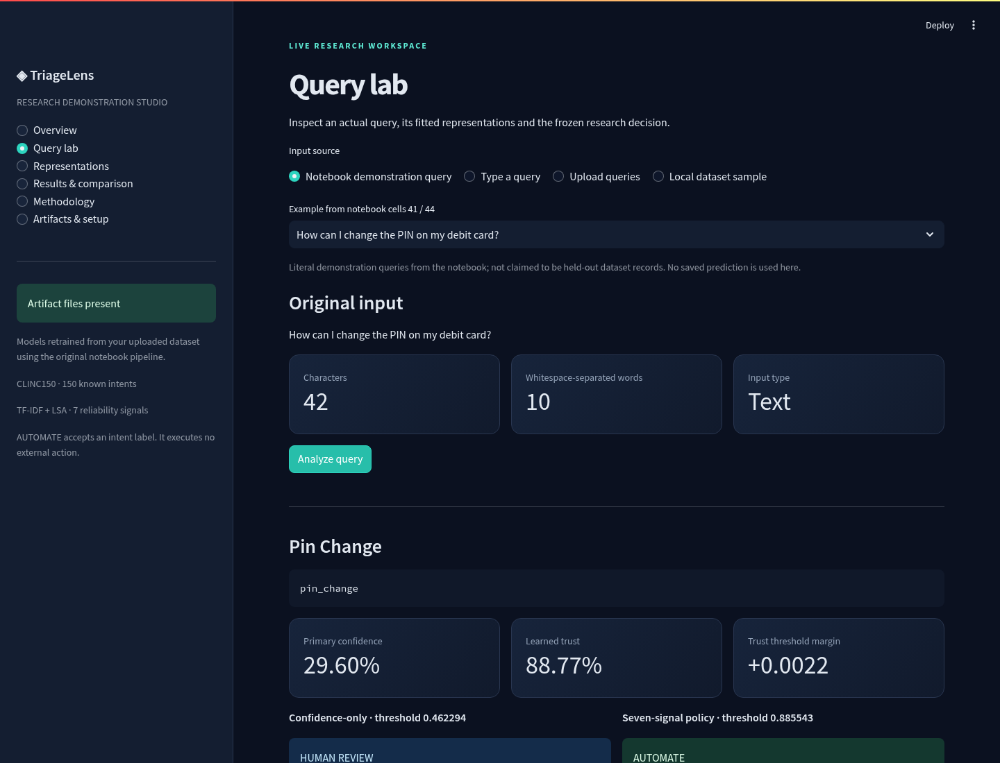
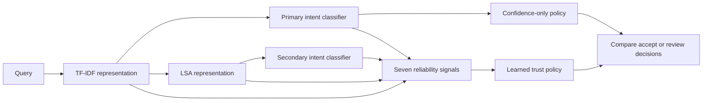

# TriageLens

A Streamlit research dashboard for exploring when an intent classifier should accept a prediction or defer it for review.

[**Try the live Streamlit demo**](https://triagelens-portfolio-cudxhgqfsks5j2gjabkf2u.streamlit.app/) · [Research notebook](notebooks/research.ipynb)

**Held-out result:** The seven-signal policy lowered modeled decision cost by **8.75%** versus confidence alone under the study's cost assumptions.



## Overview

TriageLens is a master's data science project about **selective classification**. An intent classifier can assign a familiar label to a request it has never been trained to handle. TriageLens compares two ways to decide whether to accept the predicted label or defer it for review: a confidence threshold and a learned score that combines confidence with six other signals.

In **Query lab**, select a notebook example or enter a query of your own. Try “How can I change the PIN on my debit card?” to see the predicted intent, the two policy decisions, and the signals behind them. The dashboard simulates the decision to accept or review a label.

## What it does

- Inspects the predicted intent and seven signals used to score prediction reliability.
- Compares a confidence-only policy with a learned trust policy on in-scope and out-of-scope queries.
- Visualizes the trade-off between accepting more predictions and making more errors.

## Held-out result

The local reproduction evaluated both frozen policies on **4,500 known-intent** and **1,000 out-of-scope** CLINC150 test queries. Results were weighted to an assumed **18% out-of-scope prevalence**. An incorrect acceptance costs 10 units, a review costs 1, and a correct acceptance costs 0.

| Policy | Coverage | Error rate among accepted queries | Out-of-scope queries accepted | Expected cost per query |
| --- | ---: | ---: | ---: | ---: |
| Confidence only | 35.6% | 2.35% | 1.60% | 0.728 |
| Seven-signal trust | 48.3% | 3.04% | 2.90% | 0.664 |

The learned policy accepted **12.7 percentage points more queries** and lowered modeled cost, while accepting a higher share of incorrect and out-of-scope predictions. The preferred policy depends on the relative cost of a mistake and a review. [Full test results](triagelens_results/final_test_results.csv)

## Architecture



1. **Represent the query.** TF-IDF captures weighted word usage. Latent semantic analysis (LSA) projects that representation into a lower-dimensional space.
2. **Predict an intent.** The primary classifier predicts the label from TF-IDF. A second classifier uses the LSA representation and provides a second probability distribution for comparison.
3. **Measure reliability.** The trust model combines primary confidence, nearest-neighbor similarity and weighted five-neighbor agreement in each representation, agreement between the two probability distributions, and whether the primary label matches the LSA neighbor vote.
4. **Apply frozen thresholds.** The baseline thresholds primary confidence. TriageLens thresholds the learned trust score. The dashboard displays the two decisions side by side.

## Engineering highlights

- **Fit on research data and reuse at inference.** The dashboard loads exported classifiers, transforms, reference vectors, and thresholds. Incoming queries pass through those fitted components.
- **Evaluate the decision policy separately.** Thresholds are selected on validation data and frozen before testing. Coverage, selective risk, and out-of-scope acceptance show what changes when the acceptance policy changes.
- **Expose the signals in the UI.** Recruiters can inspect both classifiers' distributions and see how neighborhood and agreement signals relate to the accept-or-review decision.

## Tech stack

| Layer | Tools |
| --- | --- |
| Modeling | Python 3.12, scikit-learn, NumPy, SciPy, and joblib for feature transforms, predictions, sparse similarity, and serialized model artifacts |
| Dashboard | Streamlit and Plotly for the interactive query lab and evaluation views |
| Research | Jupyter and pandas for the experiment notebook, analysis, and results tables |

## Repository guide

| Path | Purpose |
| --- | --- |
| [`app.py`](app.py) | Main dashboard and Streamlit Cloud entry point |
| [`triagelens/`](triagelens/) | Input validation, preprocessing, inference, and evaluation |
| [`notebooks/research.ipynb`](notebooks/research.ipynb) | Research workflow with saved charts and metrics |
| [`triagelens_models/`](triagelens_models/) and [`triagelens_results/`](triagelens_results/) | Saved model components, frozen configuration, and test results |
| [`evidence/`](evidence/) and [`docs/`](docs/) | Saved evaluation evidence and dashboard screenshots |

## Run locally

From the repository folder, use Python 3.12 and PowerShell.

```powershell
py -3.12 -m venv .venv
.\.venv\Scripts\python.exe -m pip install -r requirements.txt
.\.venv\Scripts\python.exe -m streamlit run app.py
```

Live inference requires trusted exported files in `triagelens_models/` and `triagelens_results/experiment_config.json`. Keep them beside `app.py` or set `TRIAGELENS_PROJECT_DIR` to the folder containing them. Some dashboard views also require the original `evidence/` exports. The deployment copy includes the trained model files, frozen configuration, and saved evidence. The raw dataset is optional and is needed to recompute the held-out evaluation.

